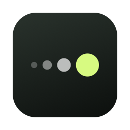
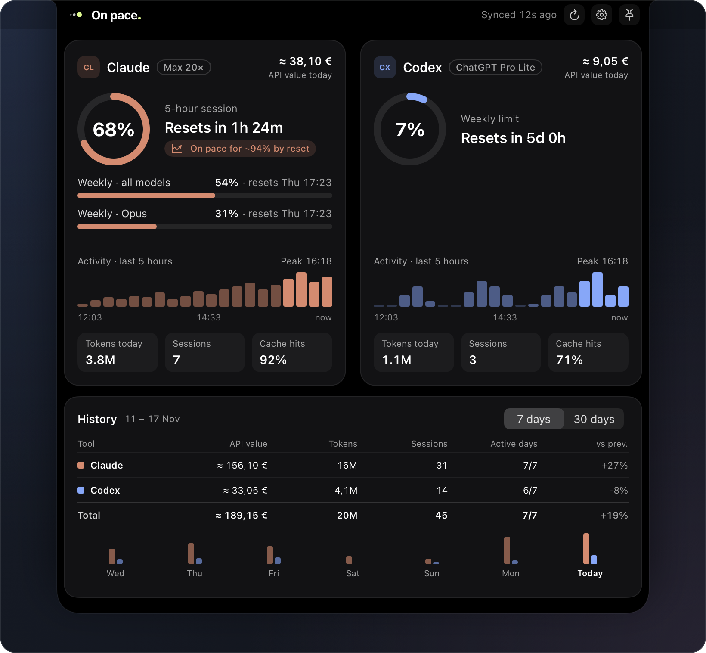

<p align="center">
  
</p>

<h1 align="center">On pace.</h1>

<p align="center">Claude Code and Codex usage at a glance in your Mac's notch.</p>

<p align="center"><a href="https://github.com/sandergo90/on-pace/releases">Download for macOS</a> · macOS 14+</p>

## See it in action

<p align="center">
  
</p>

Hover over the notch to see reset times, recent activity, and usage history.

<p align="center">
  
</p>

The screenshots show sample usage. The Codex ring shows the weekly limit when a five-hour limit is unavailable.

## Install

1. Open [GitHub Releases](https://github.com/sandergo90/on-pace/releases).
2. Download the macOS ZIP and unzip it.
3. Move **On pace.** to Applications and open it.

Use macOS 14 or later on a Mac with Apple silicon or an Intel processor. Install and sign in to the command-line tool for each provider you want to track. [Claude Code setup](https://code.claude.com/docs/en/quickstart) · [Codex setup](https://developers.openai.com/codex/cli)

## Use the notch

- The notch shows the reported five-hour limit, or the weekly limit when the five-hour limit is unavailable.
- Hover for the breakdown. Click the notch or use the pin to keep it open.
- Choose **7 days** or **30 days** to compare activity with the preceding period. The app remembers your choice.
- Open **Settings** to manage hover, open **About**, or quit.
- On a display without a camera notch, the meter appears below the menu bar.

## Usage data

On pace. reads session logs on your Mac for tokens, cache hits, sessions, and activity. It requests quota readings through your installed CLI tools and their existing sign-ins. The app keeps no separate copy of your credentials. It checks for updates every minute and dims the last quota reading after five minutes without a fresh one.

API values are estimates in euros based on the published rates and exchange rate in `StandardTokenRates.swift`. If the app can price only some of the logged tokens, it labels the estimate as partial.

The Claude Code quota reader uses the CLI's internal `get_usage` command. A CLI update can change its behavior. Codex quota windows depend on what your account reports.

## Build from source

Open `UsageNotch.xcodeproj` in Xcode and choose **Product > Run**. You can also build from Terminal.

```sh
xcodebuild -project UsageNotch.xcodeproj -scheme UsageNotch -configuration Release -destination 'platform=macOS' -derivedDataPath .build/xcode build
open ".build/xcode/Build/Products/Release/On pace..app"
```

If you edit `project.yml`, run `xcodegen generate` to refresh the Xcode project.

## License

The source is available under the [MIT License](LICENSE). On pace. is an independent Kodeus app. The notch design was inspired by [Agent HUD](https://github.com/jazzenchen/agent-hud-open).
